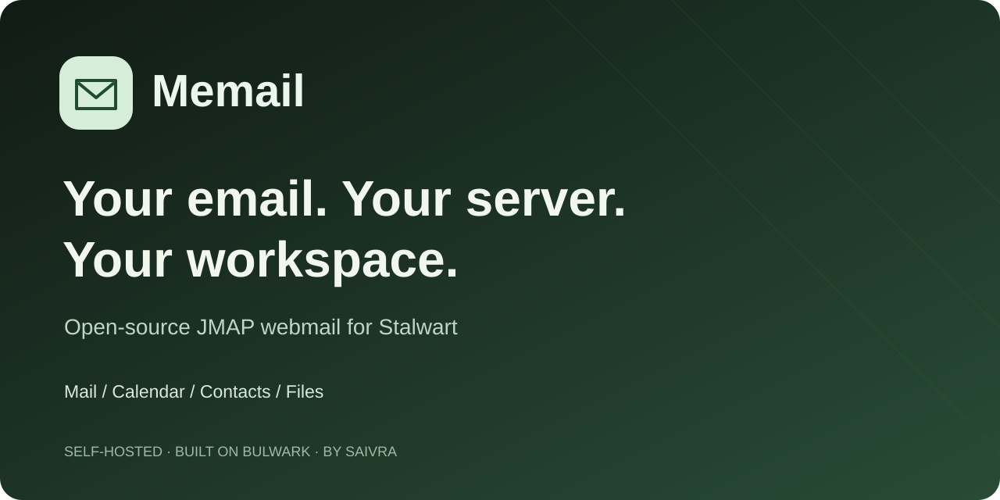
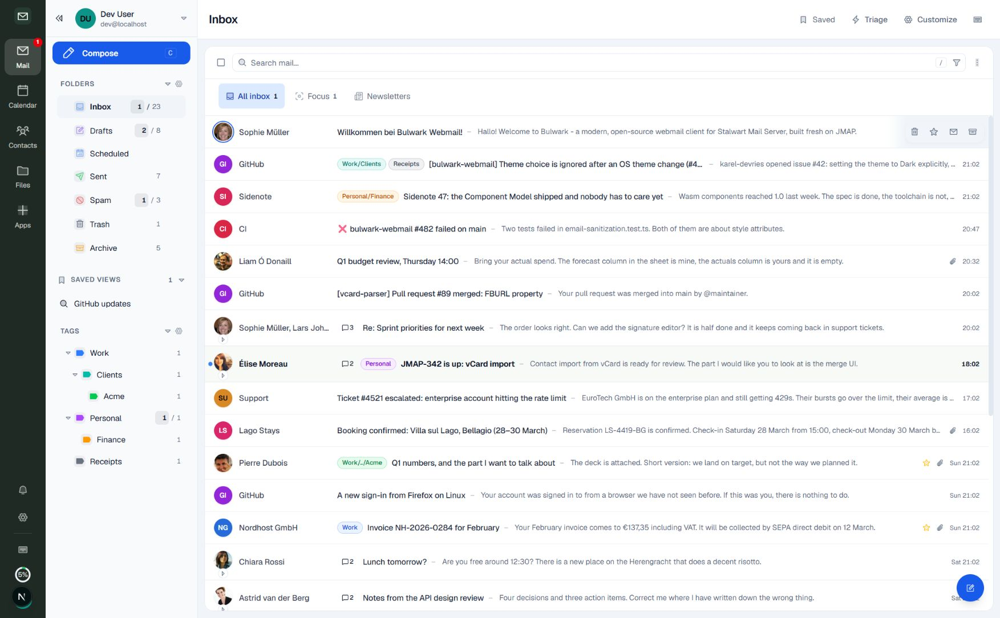
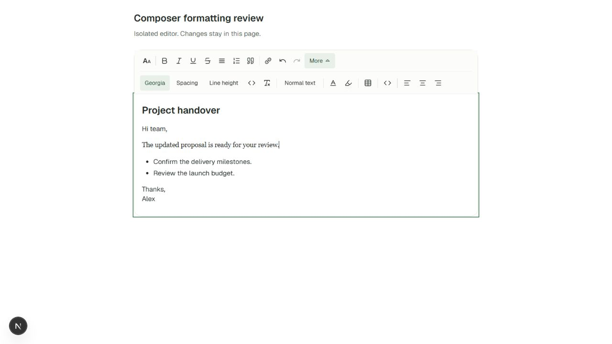
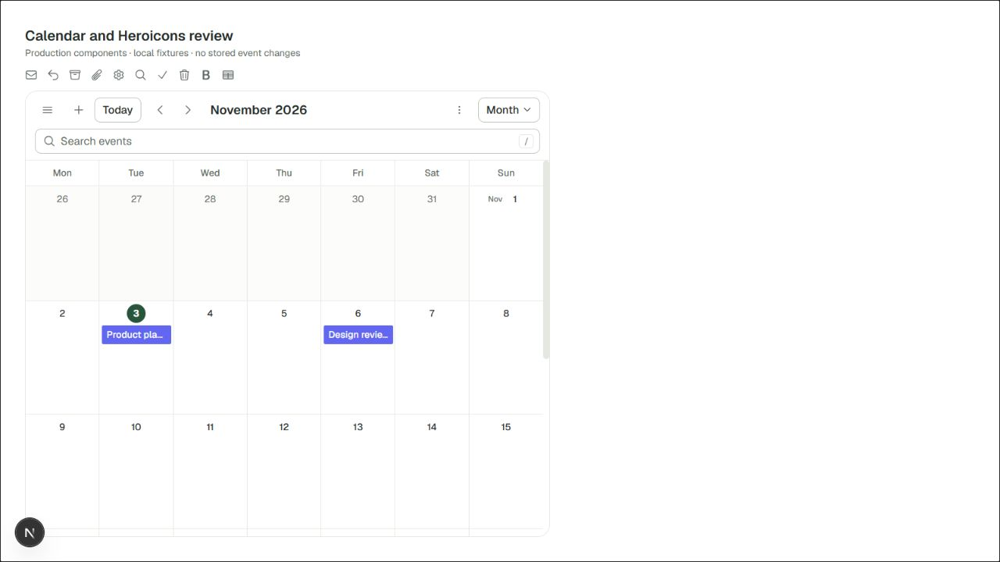

<p align="center"></p>

<h1 align="center">Memail</h1>
<p align="center"><strong>Your email. Your server. Your workspace.</strong><br>Open-source, self-hosted JMAP webmail for Stalwart Mail Server.</p>
<p align="center"><a href="#quick-start">Get started</a> · <a href="docs/DEPLOYMENT.md">Deploy & upgrade</a> · <a href="https://github.com/Saivra/memail-webmail/releases">Releases</a> · <a href="https://github.com/Saivra/memail-webmail/discussions">Community</a></p>

[](https://github.com/Saivra/memail-webmail/releases) [](LICENSE) [](https://github.com/Saivra/memail-webmail/actions/workflows/tests.yml)

Memail brings mail, calendar, contacts and files into one browser workspace. It builds on [Bulwark Webmail](https://github.com/bulwarkmail/webmail), with a distinct interface, consistent Heroicons, keyboard navigation, a rich-text composer and attention to the interactions that make everyday email easier.

**Public preview: `0.2.0-preview.1`.** Core UI comes first. Multi-provider AI is planned and **not enabled by this release**. Read the [roadmap](.memail/DESIGN-ROADMAP.md), [changelog](CHANGELOG.md) and [validation record](.memail/VALIDATION.md).



*Synthetic demo mail captured during the UI rollout. Individual icons and spacing can differ from the final preview.*

## A workspace for everyday mail

| Area | What you can do |
| --- | --- |
| **Mail & triage** | Conversations, Focus/Newsletter views, account-scoped saved searches, density controls and keyboard actions. |
| **Rich composition** | Rich text, Markdown/HTML import, fonts, lists, tables, links and attachments. Paste preserves supported formatting; complex Word/Docs layouts need a client-to-client check. |
| **Search** | Native mail filters, removable criteria, searchable settings and Calendar search with navigation within each pane. |
| **Calendar** | Day/week/month/agenda views, recurring events, invitations, visibility controls and phone navigation. |
| **Contacts** | Address books, groups, presence filters, responsive profiles, section shortcuts, vCard import/export and directory views. |
| **Files** | JMAP storage, supported previews and sharing, with persistent actions beside keyboard-scrollable details. |
| **Your workspace** | Light/dark themes, density/accessibility settings, multiple accounts, supported plugins and deployment branding. |

Availability depends on server capabilities, permissions, policy and edition. Stalwart is the primary compatibility target. Memail is a JMAP client, not a direct IMAP/SMTP bridge; other JMAP servers are not yet a tested compatibility promise.

## See the interface

| Rich-text composer | Calendar navigation |
| --- | --- |
|  |  |

These development component previews use synthetic content, not customer mail. See the [phone file-details preview](docs/images/files-details-phone.jpg) and [validation limits](.memail/VALIDATION.md). Contact-profile visual acceptance remains open.

## Quick start

### Try the synthetic demo

```sh
git clone https://github.com/Saivra/memail-webmail.git
cd memail-webmail
npm ci
node .memail/demo.mjs
```

Open `http://127.0.0.1:3000` and use any demo username/password. This loopback launcher uses synthetic JMAP data. Do not expose it publicly or use real credentials. Use Node 22 or a compatible newer version.

### Self-host with Docker

```sh
git clone --branch v0.2.0-preview.1 --depth 1 https://github.com/Saivra/memail-webmail.git
cd memail-webmail
docker build -t memail:0.2.0-preview.1 .
docker compose -f deploy/memail/compose.yml up -d
```

Open `http://localhost:3000`. The setup wizard connects Stalwart and configures administration. The example persists `/app/data` in a named volume. Configure HTTPS for public use and read the [deployment, backup and upgrade guide](docs/DEPLOYMENT.md).

Memail is a full client deployment, not a plugin for unchanged Bulwark. Optional theme and Focus plugin packages provide only those individual features.

## Releases and operations

- [Releases](https://github.com/Saivra/memail-webmail/releases): source revisions, status, assets and known limits. Container publishing runs separately; use an image tag only after its workflow succeeds and the release lists it.
- [Deployment guide](docs/DEPLOYMENT.md): fresh installs, existing installations, backups, canary checks and rollback.
- [Release policy](docs/RELEASING.md), [development/branding](.memail/DEVELOPMENT.md), and [upstream maintenance](.memail/UPSTREAM.md).

Stored branding can override Memail defaults. The product release is separate from Bulwark `1.19.1`, retained for upstream protocol/marketplace compatibility.

## Contribute and share

Read [CONTRIBUTING.md](CONTRIBUTING.md), report bugs in [Issues](https://github.com/Saivra/memail-webmail/issues), and discuss workflows in [Discussions](https://github.com/Saivra/memail-webmail/discussions). Stalwart testing, accessibility, RTL/localization, rich-paste samples and mobile polish are useful contributions.

If Memail helps you, star the repository, share a tested installation guide, or show your setup in Discussions. Keep private mail and credentials out of screenshots. [Sponsorship setup](SPONSORSHIP.md) records the funding status; no Memail payment destination is active yet.

## Built on Bulwark

Memail is maintained by **Saivra** as an independent downstream fork. Bulwark provides the JMAP foundation and much of the application. [Downstream patches](.memail/PATCHES.md), [credits](CREDITS.md) and the [preserved upstream changelog](docs/UPSTREAM-CHANGELOG.md) record that relationship. Upstream documentation remains useful for shared capabilities; interfaces and release processes differ.

## License and security

[AGPL-3.0-only](LICENSE), including the additional permission stated there. [NOTICE](NOTICE) and third-party notices are retained. Use [SECURITY.md](SECURITY.md) for private vulnerability reporting. No commercial UI block source is included.
